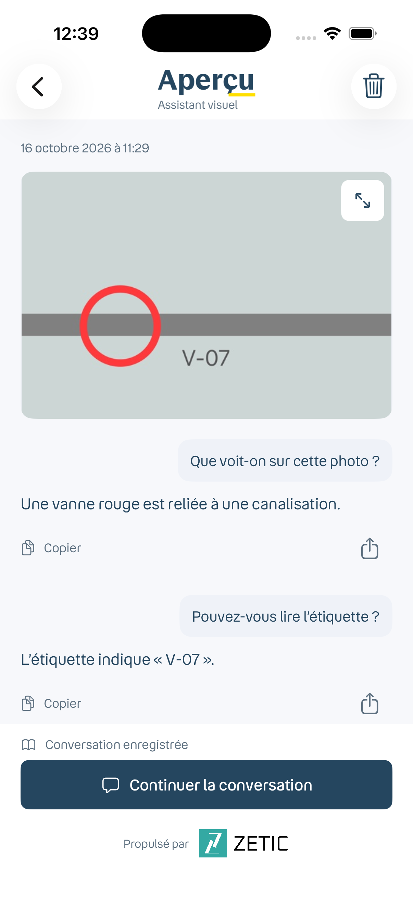
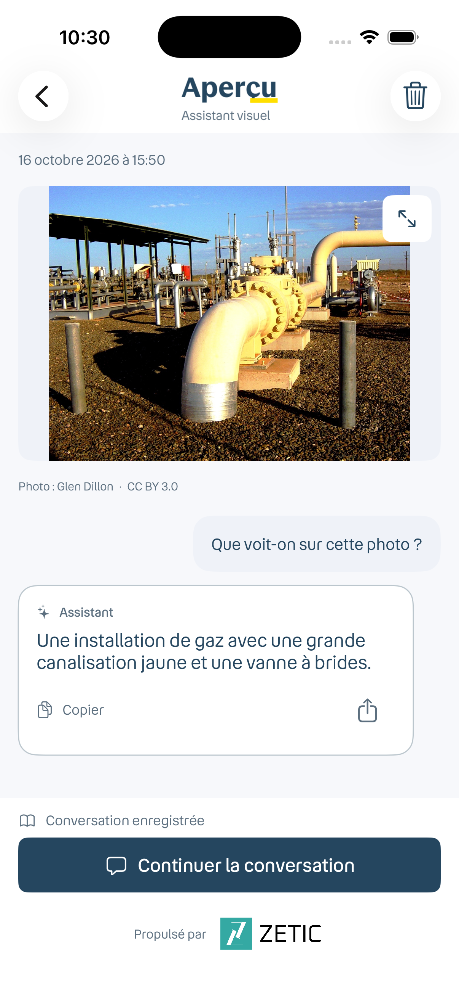

# Aperçu native design refinement

This change is stacked on PR #4 (`codex/apercu-ios-history`). It changes iOS only.

| Previous PR #4 preview | Updated native screen |
| --- | --- |
|  |  |

Both are simulator captures with illustrative dialogue; neither demonstrates model inference. The updated image is a real gas-pipeline photograph, not a customer site. Photo: Glen Dillon, [CC BY 3.0](https://creativecommons.org/licenses/by/3.0/), [source](https://commons.wikimedia.org/wiki/File:MainLineValve7.jpg).

- Distinct left-aligned, white outlined AI replies and right-aligned tinted questions.
- 16pt body, 16pt bubble/screen padding, 8pt control radius and 48pt functional actions; compact spacing uses 4pt increments.
- Navy primary actions and outlined white secondary actions. Trilogy divider and error colors match the translation demo.
- Bouygues Speak/Read remain bundled with Dynamic Type. The small yellow wordmark accent and dark palette are app adaptations; native icons, pickers and dialogs remain platform components.

Validation: Simulator Debug and unsigned iPhone Release builds passed; 14 existing archive/context tests passed. The review screen was inspected at default text size and accessibility-extra-large; the Continue action wraps without truncation. Physical-device model inference remains outside this UI validation.
