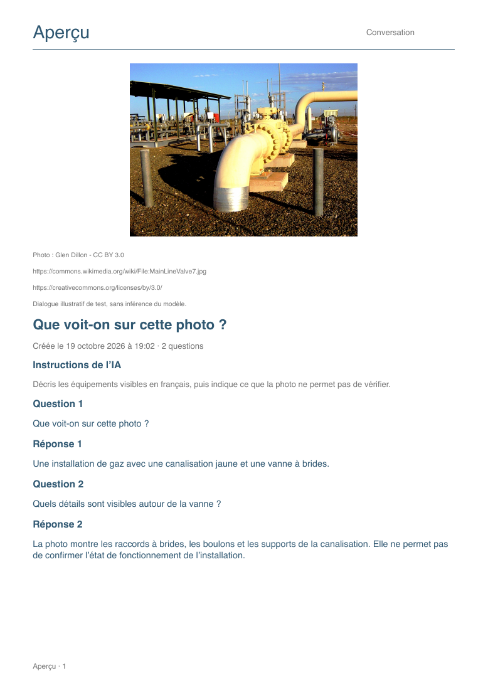

# Full-session PDF sharing

Stacked after custom AI instruction settings, which is stacked after the existing design PR. iOS offers the share control in the current conversation and every saved-session review. Android offers a session share control beside Settings for the current photo conversation.

The A4 report contains the session photo, date, captured AI instructions and every question/answer in order. Failed, interrupted and partial answers are labeled and retained. The report uses searchable text with native pagination instead of screenshots, and can span multiple pages without dropping older or longer turns. Export requires a photo and at least one question; unavailable photos or failed writes produce an error instead of a partial report. Live export is disabled during generation or image replacement.

The report is generated on-device and passed to the system share sheet. The app does not choose a recipient or send automatically. iOS removes its temporary copy after the share sheet finishes; Android keeps its narrowly scoped FileProvider copy available for the receiving app, and expires old copies after 24 hours on a later export. Photo archives and transcripts are never removed by export cleanup. Settings, model downloads and model availability do not gate saved-session exports.

## Preview

The preview uses the existing gas-pipeline photo by Glen Dillon (CC BY 3.0); attribution/source/license links are included in the example PDF. Dialogue is illustrative fixture text, not model output.

## Validation

- 20 Swift package tests passed, including PDF extraction of first/last turns, captured instructions, interrupted status and French/Korean/Japanese text across multiple pages; an unavailable photo produces no partial PDF.
- iOS Simulator and unsigned iPhone Release builds passed with an empty key.
- Android: 14 unit tests, debug APK build, lint and instrumentation-source compilation passed. Native PDF/FileProvider instrumentation coverage is prepared; no Android phone/emulator is connected, so device execution remains pending.
- Short (one page) and long (10 pages) PDFs were generated with the same native renderer, rendered with Poppler and visually checked. Text extraction retains the ending and status.
- Native iOS saved-session export was exercised without a loaded model: a 1.1 MB PDF was generated, the system share sheet opened, and the resulting file was rendered for inspection.
- Real model instruction-following and physical-device acceptance remain separate from PDF/fixture validation. No email or message was sent during validation.
